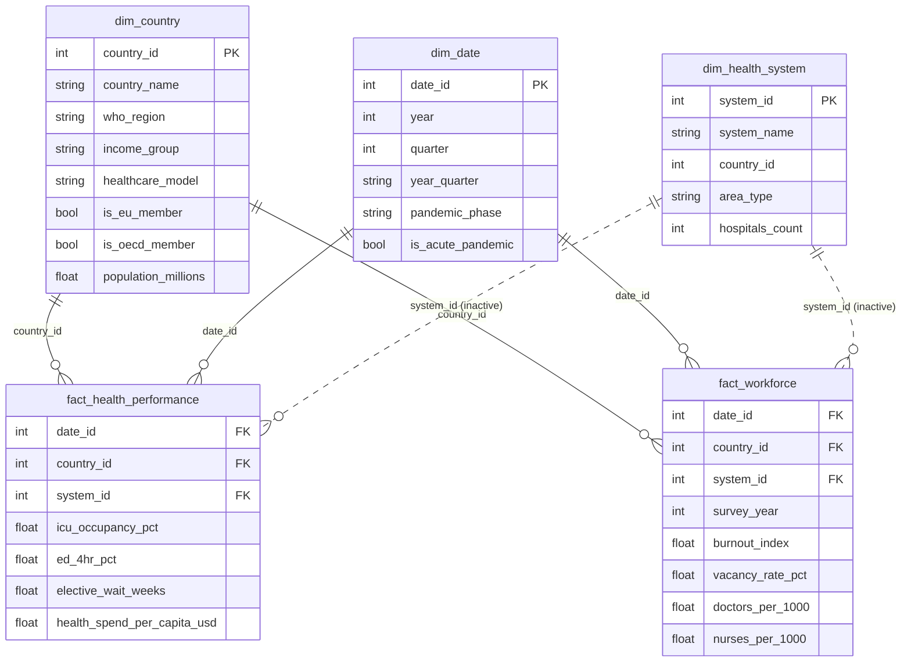

# Healthcare Systems Performance & Intelligence Dashboard

> A data-driven analysis of healthcare access, workforce sustainability, patient outcomes and financial performance (2018–2024).
> Built in Power BI for the **DataDNA Dataset Challenge, November 2026**.


> **Data note:** This project uses the synthetic dataset supplied for the DataDNA November 2026 challenge. All figures are simulated and must not be read as actual NHS or international healthcare performance.

---

## Table of Contents

1. [Project Overview](#project-overview)
2. [Business Questions](#business-questions)
3. [Dataset](#dataset)
4. [Data Model](#data-model)
5. [DAX Measures](#dax-measures)
6. [Dashboard Pages](#dashboard-pages)
7. [Key Insights](#key-insights)
8. [Strategic Priorities](#strategic-priorities)
9. [Tools & Technologies](#tools--technologies)
10. [Business Value](#business-value)
11. [Repository Structure](#repository-structure)
12. [How to Use](#how-to-use)
13. [Limitations](#limitations)
14. [Conclusion](#conclusion)

---

## Project Overview

This project is a four-page Power BI dashboard that analyses how healthcare systems absorbed the COVID-era shock, which systems recovered, and what continuing workforce pressure and disease trends mean for healthcare planning.

It covers **212 health systems across 32 countries and 6 WHO regions**, with **5,936 quarterly performance records** and **1,484 annual workforce records** from 2018 to 2024 (28 quarters, 7 survey years).

A key design choice is that every KPI is read against an explicit baseline (2019, 2018 or the Pre-Pandemic phase), so recovery is judged and not assumed. Each KPI card pairs a value with a DAX-driven reference label such as `vs 2019 +3.36 weeks`.

The dashboard provides insight into:

- Intensive-care (ICU) occupancy and pandemic-phase pressure
- Emergency-department (ED) 4-hour performance
- Elective waiting times and the treatment backlog
- Respiratory illness trends
- UK versus EU elective-wait recovery
- Health spending per person
- Staff burnout and workforce vacancy rates
- Doctors and nurses per 1,000 population
- International recruitment
- Cardiovascular, diabetes and cancer burden
- 30-day readmission rates
- Regional and income-group differences

---

## Business Questions

1. How much did ICU occupancy and respiratory illness rise during the Acute pandemic phase?
2. When did ED 4-hour performance fall furthest, and has it recovered?
3. How large was the elective-wait backlog, and how much has been cleared by 2024?
4. Did the UK recover more slowly than the EU comparison group?
5. How did burnout and vacancy rates change, and are they related?
6. How do doctors and nurses per 1,000 differ across income groups?
7. How does UK health spending per person compare with the EU?
8. Are cardiovascular, diabetes and cancer burdens rising, and where?
9. Did 30-day readmission change over the period?

---

## Dataset

| Table | Type | Rows | Purpose |
|---|---|---:|---|
| `dim_country` | Dimension | 32 | Country, WHO region, income group, healthcare model, EU/OECD flags, population |
| `dim_health_system` | Dimension | 212 | Regional health systems, area type, hospital count, population |
| `dim_date` | Dimension | 28 | Quarters, year, UK fiscal year, pandemic phase, acute-pandemic flag |
| `fact_health_performance` | Fact | 5,936 | Quarterly clinical, operational, spending and disease indicators |
| `fact_workforce` | Fact | 1,484 | Annual burnout, vacancies, doctors, nurses and recruitment |
| **Total** | | **7,692** | |

**Data quality checks:** no missing values, no duplicate rows, no invalid foreign keys, and complete quarterly and annual coverage for all 212 systems.

> **Modelling rule:** the indicators are rates, percentages, indices and per-person values, so the model uses **averages, never sums**. Percentage columns store values such as `72.31` (meaning 72.31%), so measures use a custom number format and not Power BI's percentage format.

---

## Data Model

A star schema with two fact tables, three dimensions, a measures table and a disconnected helper table for the elective-wait waterfall.




**Design notes**

- Single-direction, one-to-many relationships run from `dim_country` and `dim_date` to both fact tables.
- `dim_health_system` relationships are kept **inactive** to avoid ambiguous filter paths between country and system.
- A dedicated **Measures table** keeps all DAX in one place.
- A disconnected **Elective Waterfall Steps** table (`Step`, `SortOrder`) drives the waterfall bridge.

---

## DAX Measures

All measures live in the Measures table. Percentage measures use the format `0.00"%"`.

### Base measures

```dax
Avg ICU Occupancy = AVERAGE ( fact_health_performance[icu_occupancy_pct] )

Avg ED Performance = AVERAGE ( fact_health_performance[ed_4hr_pct] )

Avg Elective Wait = AVERAGE ( fact_health_performance[elective_wait_weeks] )

Avg Health Spending = AVERAGE ( fact_health_performance[health_spend_per_capita_usd] )

Avg Burnout = AVERAGE ( fact_workforce[burnout_index] )

Avg Vacancy Rate = AVERAGE ( fact_workforce[vacancy_rate_pct] )

Health Systems = DISTINCTCOUNT ( dim_health_system[system_id] )

Countries = DISTINCTCOUNT ( dim_country[country_id] )
```

### Baseline measures (fixed comparison periods)

```dax
ICU 2019 =
CALCULATE (
    [Avg ICU Occupancy],
    REMOVEFILTERS ( dim_date ),
    dim_date[year] = 2019
)

ICU Acute =
CALCULATE (
    [Avg ICU Occupancy],
    REMOVEFILTERS ( dim_date ),
    dim_date[pandemic_phase] = "Acute Pandemic"
)

ICU Pre Pandemic =
CALCULATE (
    [Avg ICU Occupancy],
    REMOVEFILTERS ( dim_date ),
    dim_date[pandemic_phase] = "Pre-Pandemic"
)

Burnout 2022 =
CALCULATE (
    [Avg Burnout],
    REMOVEFILTERS ( dim_date ),
    fact_workforce[survey_year] = 2022
)
```

### Dynamic KPI reference labels

```dax
Wait Reference Label =
VAR Delta = [Avg Elective Wait] - [Wait 2019]
RETURN
    "vs 2019 " & FORMAT ( Delta, "+0.00;-0.00;0.00" ) & " weeks"

ICU Acute Reference Label =
VAR Delta = [ICU Acute] - [ICU Pre Pandemic]
RETURN
    "vs Pre-Pandemic " & FORMAT ( Delta, "+0.00;-0.00;0.00" ) & " pp"

Spending Reference Label =
VAR Delta =
    DIVIDE ( [Avg Health Spending] - [Spending 2018], [Spending 2018] ) * 100
RETURN
    "vs 2018 " & FORMAT ( Delta, "+0.0;-0.0;0.0" ) & "%"
```

### UK versus EU comparison

```dax
UK Elective Wait =
CALCULATE (
    [Avg Elective Wait],
    REMOVEFILTERS ( dim_country ),
    dim_country[country_name] = "United Kingdom"
)

EU Elective Wait =
CALCULATE (
    [Avg Elective Wait],
    REMOVEFILTERS ( dim_country ),
    dim_country[is_eu_member] = TRUE ()
)

UK EU Waiting Gap = [UK Elective Wait] - [EU Elective Wait]
```

### Burnout and vacancy correlation

```dax
Burnout Vacancy Correlation =
VAR T =
    FILTER (
        fact_workforce,
        NOT ISBLANK ( fact_workforce[vacancy_rate_pct] )
            && NOT ISBLANK ( fact_workforce[burnout_index] )
    )
VAR AvgX = AVERAGEX ( T, fact_workforce[vacancy_rate_pct] )
VAR AvgY = AVERAGEX ( T, fact_workforce[burnout_index] )
VAR Numerator =
    SUMX ( T, ( fact_workforce[vacancy_rate_pct] - AvgX ) * ( fact_workforce[burnout_index] - AvgY ) )
VAR Denominator =
    SQRT (
        SUMX ( T, ( fact_workforce[vacancy_rate_pct] - AvgX ) ^ 2 )
            * SUMX ( T, ( fact_workforce[burnout_index] - AvgY ) ^ 2 )
    )
RETURN
    DIVIDE ( Numerator, Denominator )
```

---

## Dashboard Pages

Each page has five KPI cards, six visuals and a slicer panel (Year, Country, Income Group).

### Page 1: Executive Overview


KPI cards show full-period (2018–2024) averages against a baseline.

| KPI | Value | Reference |
|---|---:|---|
| ICU Occupancy | 75.01% | vs 2019 +3.00 pp |
| Elective Waiting Time | 12.37 weeks | vs 2019 +3.36 weeks |
| ED 4-Hour Performance | 74.36% | vs 2019 −6.83 pp |
| Avg Health Spending | $4,761 per person | vs 2018 +11.3% |
| Health Systems Analysed | 212 | 32 countries analysed |

**Visuals:** ICU occupancy trend · elective waiting-time trend · ED performance by WHO region · top 6 countries by ICU occupancy · health spending per person · ICU occupancy by pandemic phase.

**Findings**

- ICU occupancy is flat at about 72% until early 2020, peaks near 84% in 2021 Q1, and returns to about 72% by 2023–2024.
- Elective waits rise from about 9 weeks to roughly 17 weeks in 2021, and are still about 11.7 weeks in 2024.
- ED 4-hour performance ranges from about 78% in Europe to about 63% in the Eastern Mediterranean, a gap of roughly 15 points.
- The highest period-average ICU occupancy is in Spain (84%), the UK (83%), South Korea (80%), Brazil (80%), France (79%) and Denmark (79%).
- Health spending per person rises steadily, from about $4,278 in 2018 to $5,274 in 2024 (about +23%).

### Page 2: Pandemic & Recovery


KPI cards are fixed historical comparisons and do not change with the Year slicer.

| KPI | Value | Reference |
|---|---:|---|
| ED Recovery Performance | 65.09% | vs Pre-Pandemic −16.00 pp |
| Acute ICU Occupancy | 81.81% | vs Pre-Pandemic +9.51 pp |
| Peak Elective Wait (2021) | 16.98 weeks | vs 2019 +7.96 weeks |
| Elective Waiting Time 2024 | 11.69 weeks | vs 2019 +2.67 weeks |
| Acute Respiratory Illness | 10.69% | vs Pre-Pandemic +1.81 pp |

**Visuals:** ICU vs ED 4-hour performance by quarter · respiratory prevalence trend · respiratory prevalence by phase · Acute ICU occupancy by country · elective-wait waterfall bridge · UK vs EU elective wait.

**Findings**

- ICU peaks in 2021 Q1 (about 84%), whereas ED performance does not bottom out (about 64.6%) until 2022 Q3.
- The waterfall bridge runs 9.02 weeks (2019), then +7.96 to the 2021 peak, then −5.29 recovery, ending at 11.69 weeks (2024).
- By 2024 the UK averages **15.49 weeks versus 11.49 for the EU**, a gap of 4.0 weeks and about double the UK's own 2019 level (7.80).

### Page 3: Workforce & Resources


| KPI | Value | Reference |
|---|---:|---|
| Staff Burnout Index | 65.20 | vs 2022 −7.06 points |
| Workforce Vacancy Rate | 8.62% | vs 2022 −2.44 pp |
| Doctors per 1,000 | 3.05 | vs 2018 +0.09 per 1,000 |
| Nurses per 1,000 | 9.10 | vs 2018 +0.25 per 1,000 |
| International Recruitment | 15.94% | vs 2018 +0.11 pp |

**Visuals:** vacancy rate and burnout index by year · vacancy rate by WHO region · vacancy vs burnout by country (scatter) · doctors and nurses per 1,000 by year · doctors and nurses by income group · health spend per person, UK vs EU.

**Findings**

- Burnout rises every year from about 58.1 (2018) to a peak of 72.3 (2022), then falls to 63.7 (2024). Vacancies follow the same shape (about 6.8% to 11.1% to 8.0%).
- Burnout and vacancy correlate at about **+0.58** across all 1,484 workforce records: a moderate association, not proof of cause.
- Vacancy is highest in South-East Asia (11.2%), the Eastern Mediterranean (10.3%) and Africa (10.2%).
- High-income systems have 3.7 doctors and 11.3 nurses per 1,000, against 0.1 and 1.0 in low-income systems (over 30 times the doctors).
- EU spending per person exceeds UK spending in every year, by roughly 13–14%.

### Page 4: Disease Burden & Actions


| KPI | Value | Reference |
|---|---:|---|
| Cardiovascular Prevalence | 9.02% | vs 2018 +0.44 pp |
| Diabetes Prevalence | 7.34% | vs 2018 +0.35 pp |
| Cancer Incidence | 545.89 per 100k | vs 2018 +9.18 per 100k |
| 30-Day Readmission | 13.24% | vs 2018 −0.05 pp |
| Respiratory Prevalence | 9.35% | vs 2018 +0.51 pp |

**Visuals:** cardiovascular trend by WHO region · cardiovascular and diabetes by WHO region · 30-day readmission trend · cancer incidence by income group · cancer incidence by pandemic phase · cardiovascular prevalence by country.

**Findings**

- Cardiovascular prevalence rises in every WHO region, by roughly 0.14 to 0.19 pp per year.
- Diabetes is highest in the Eastern Mediterranean (about 21%), and exceeds cardiovascular prevalence in the Eastern Mediterranean, South-East Asia, the Americas and Africa.
- Recorded cancer incidence is about 676 per 100k in high-income groups against about 72 in low-income groups (over 9×), likely reflecting diagnosis and registration differences.
- Readmission stays in a narrow band of about 12.5–14.3% with no long-term change.
- Germany has the highest cardiovascular prevalence (12.9%), followed by Denmark (10.8%) and the UK (10.7%).

---

## Key Insights

- ICU occupancy rose from 72.31% (Pre-Pandemic) to 81.81% (Acute), then normalised by 2023.
- ED 4-hour performance fell furthest in the Recovery phase, to 65.09% (−16.00 pp).
- Elective waits peaked at 16.98 weeks in 2021 and stood at 11.69 weeks in 2024, still 2.67 weeks above 2019.
- The UK recovered more slowly than the EU: 15.49 versus 11.49 weeks in 2024.
- Burnout and vacancies peaked together in 2022 (72.3 and 11.1%).
- Workforce capacity differs far more between income groups than it changes over time.
- Chronic disease (cardiovascular, diabetes) is rising steadily in every region.
- All findings are associations in simulated data, not proven causes.

---

## Strategic Priorities

| Priority | Evidence |
|---|---|
| Complete the elective recovery | Waits still +2.67 weeks vs 2019; UK +4.0 weeks vs EU |
| Protect emergency-department performance | ED 4-hour fell 16 pp in Recovery and remains below 2019 |
| Invest in workforce retention | Burnout and vacancy peaked together in 2022 |
| Target high-vacancy regions | South-East Asia, Eastern Mediterranean and Africa lead |
| Address capacity inequality | 30× doctors per head, high vs low income |
| Benchmark spending against outcomes | UK spends about 13.6% less per person than the EU |
| Plan for chronic disease | Cardiovascular +0.15 pp/yr; diabetes +0.12 pp/yr |
| Build surge capacity | ICU and respiratory illness rose together in 2020–2021 |
| Treat cancer comparisons with caution | Recorded incidence reflects diagnosis capacity |
| Keep monitoring against baselines | Reference labels make recovery visible at a glance |

---

## Tools & Technologies

| Tool | Use |
|---|---|
| **Power BI** | Dashboard design, interactivity, slicers and page navigation |
| **Power Query** | Import, cleaning, transformation and validation of five tables |
| **DAX** | Averages-based measures, baselines, dynamic labels, UK-EU comparison, correlation |
| **Star Schema Modelling** | Two facts, three dimensions, measures table, waterfall helper table |
| **Correlation Analysis** | Burnout and vacancy relationship across 1,484 records |
| **Data Storytelling** | Turning pandemic, workforce and disease data into a recovery narrative |

---

## Business Value

- **Senior leaders:** monitor capacity, access and recovery against pre-pandemic baselines.
- **Planners and commissioners:** see where elective backlogs persist.
- **Emergency and critical-care managers:** understand how pressure moved from ICU to the ED.
- **Workforce and HR teams:** track burnout, vacancy and recruitment together.
- **Finance teams:** compare spend per person across the UK, EU and income groups.
- **Public-health teams:** follow cardiovascular, diabetes and cancer burden by region.
- **Policy analysts:** benchmark countries and regions on a consistent basis.

---

## Repository Structure

```text
healthcare-systems-performance-dashboard/
├── README.md
├── data/
│   ├── dim_country.csv
│   ├── dim_date.csv
│   ├── dim_health_system.csv
│   ├── fact_health_performance.csv
│   └── fact_workforce.csv
├── dashboard/
│   └── Healthcare_Systems_Performance.pbix
├── images/
│   ├── cover.png
│   ├── data_model.png
│   ├── page1_executive_overview.png
│   ├── page2_pandemic_recovery.png
│   ├── page3_workforce_resources.png
│   └── page4_disease_actions.png
└── docs/
    └── DAX_measures.md
```

---

## How to Use

1. Clone the repository: `git clone https://github.com/<your-username>/healthcare-systems-performance-dashboard.git`
2. Open `dashboard/Healthcare_Systems_Performance.pbix` in Power BI Desktop.
3. If prompted, update the data source path to the `data/` folder under **Transform data → Data source settings**.
4. Use the page buttons to navigate and the slicers (Year, Country, Income Group) to filter.

---

## Limitations

- The data is synthetic; findings describe the simulated dataset only.
- Cardiovascular and cancer measures are not age-standardised.
- Recorded cancer incidence reflects diagnosis and registration capacity as well as disease burden.
- Spending is in nominal USD and is not adjusted for purchasing power or inflation.
- Correlations are associations and do not establish causation.

---

## Conclusion

The dashboard shows that acute intensive-care pressure normalised quickly, while emergency performance, elective waiting times and staff wellbeing recovered more slowly. It also highlights structural inequalities in workforce capacity and recorded disease burden between income groups and regions, and a persistent UK-EU gap in elective waits and spending.

The project demonstrates a complete Power BI analytical workflow: data modelling, DAX development, baseline-driven KPI design, dashboard storytelling and executive recommendations.

---

